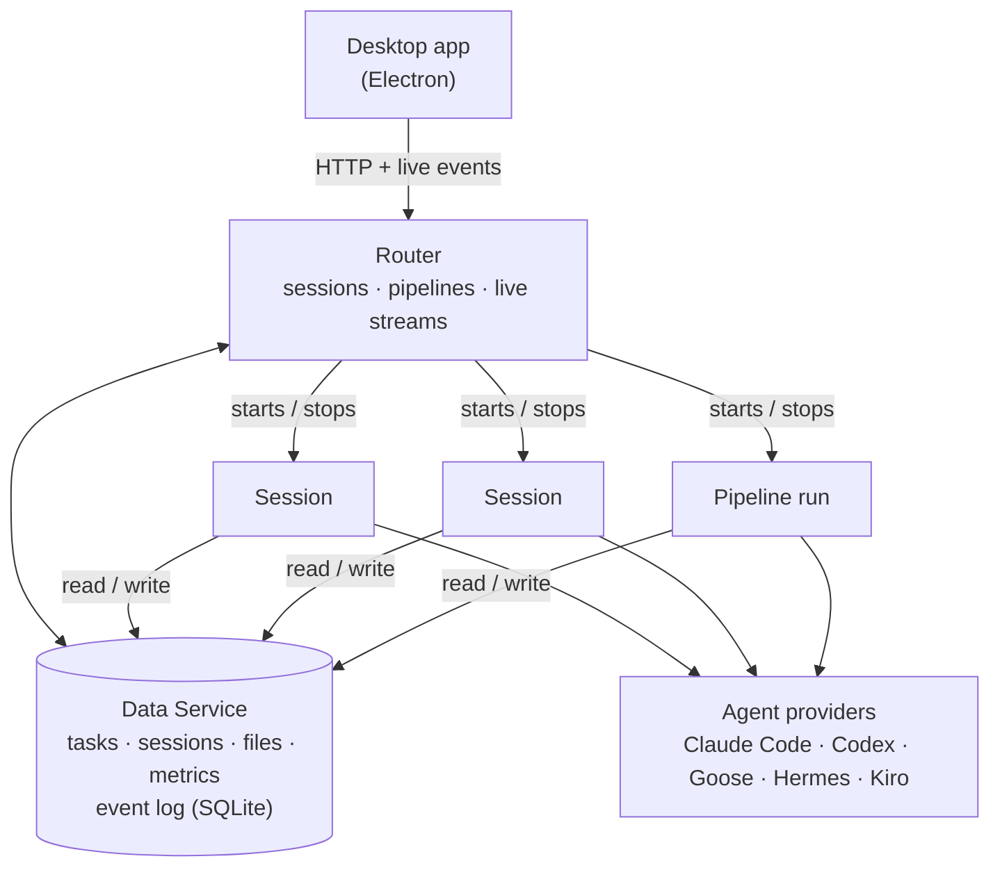

# mads — Making Agents Do Stuff

**One desktop app for every coding agent you already pay for.**

mads lets you work with Claude Code, Codex, Goose, Hermes, and Kiro from a
single place. Chat with an agent, break the work into tasks, and have a
team of agents build those tasks in parallel. You review the results and
decide what merges.

> **Status:** this is an early project under live development. There is no
> packaged release yet, so for now you run mads from a source checkout (see
> [Get started](#get-started)).

---

## What is mads?

mads is an agent orchestration platform built around three ideas:

- **Agents should be easy to use.** It shouldn't matter whether you're on
  day one or year ten. Pick a goal, start talking, and mads chooses or
  generates a suitable agent and gives it the tools it needs.
- **Agents should have what they need to do good work.** That means skills,
  MCP servers, an isolated workspace, and clear tasks with a definition of
  done.
- **You are close to your work.** Every message, tool call, file change,
  commit, and dollar spent is recorded, and you can inspect all of it.

### Highlights

- **Bring your own agent.** Claude Code, Codex, Goose, Hermes, and Kiro all
  run behind one interface. Use whatever you're subscribed to, or mix them.
- **Sessions.** Ever lost a session because you forgot which directory it
  started from? Keep track of every session from every agent (plus
  subagents) in one place. Run agents alone in a new worktree, or together
  with linked sessions.
- **Tasks and pipelines.** *(Tasks are under development.)* Turn a plan
  into a task graph, then run it through a structured loop. Each task gets
  its own worktree and branch and passes through user-defined gates.
  Customize the checks and escalation paths to suit you and your repo.
- **Retro.** Agents generate a lot of data but are bad at self-reflection.
  Use Retro to have a different agent look for issues and suggest durable
  fixes.
- **Library.** Keep your agent system prompts, skills, MCP servers, and
  pipeline templates in one place.
- **Import your history.** Your existing agent sessions come with you when
  you onboard.

---

## Get started

**You'll need:** Linux or macOS, [Go](https://go.dev) (version in `go.mod`),
Node (version in `.nvmrc`), `git`, and at least one agent CLI installed and
signed in (for example `claude`, `codex`, or `goose`). On macOS, also run
`xcode-select --install`.

```sh
git clone https://github.com/DrewGitsIt/mads.git
cd mads
make build        # builds the services and the desktop app
scripts/app.sh    # starts mads and opens the app
```

On first launch, a short setup walks you through choosing a provider and a
workspace: the folder(s) or repo(s) your agents will work in.

### Your first session

1. **Describe what you want** in the Launchpad, e.g. _"Add dark mode to the
   settings page."_ mads picks an agent and starts a session.
2. **Plan together.** For larger pieces of work, chat with the agent to
   work out an approach. Ask it to break the work into tasks, or add tasks
   yourself on the **Tasks** tab.
3. **Run it.** Start a pipeline from the Tasks tab (a default loop ships
   with mads). Agents work in parallel, each in its own isolated copy of
   your repo, and you can watch any of them live.
4. **Review and land.** Read the diffs on the **Changes** tab, then approve
   them. mads merges the approved work back to your branch.
5. **Look back.** Run a **Retro** on the session to find out what went well
   and what to change next time.

You stay in control the whole way. You can pause, cancel, or switch any
agent at any point.

---

## How it works



- The **desktop app** only displays state and sends your actions. It talks
  to the Router and nothing else.
- The **Router** is always running. It starts and stops sessions and
  pipeline runs, and streams their output to the app live.
- Each **Session** owns one running agent. Each **Pipeline run** carries a
  task graph through its stages.
- The **Data Service** is the single source of truth. Every change is
  written together with an event describing it, which is what makes
  everything observable and replayable.
- **Providers** adapt each agent CLI to a common interface, so the rest of
  mads doesn't care which agent you picked.

Everything runs locally. Your data lives in `~/.mads`.

---

## Contributing

mads is built mostly by mads, using its own pipeline. Every service is
small, runs on its own, and is tested without a live LLM.

See **[CONTRIBUTING.md](CONTRIBUTING.md)** for the dev loop, the build and
test targets, how to rebuild one piece while mads is running, and the rules
every change follows.
